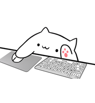
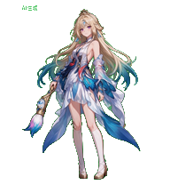

<p align="center">
  
</p>

<h1 align="center">desktop pet</h1>

<p align="center">
  <a href="README.md">中文（默认）</a> ·
  <a href="README.en.md"><strong>English</strong></a> ·
  <a href="README.ja.md">日本語</a>
</p>

<p align="center"><strong>A desktop companion you can help create: custom actions, character personas, optional plugins, and connections to multiple AI tools.</strong></p>

<p align="center">
  <a href="https://github.com/xunguangzlj-cloud/desktop-pet-community/releases/latest">Download</a> ·
  <a href="https://desktoppet-e9e.pages.dev">Community platform</a> ·
  <a href="https://github.com/xunguangzlj-cloud/desktop-pet-community/issues">Report an issue</a>
</p>

<p align="center">
  
  
  
  
  
</p>

## 1. Features

- **Desktop companionship**: Drag, resize, or hide your pet. It stays quietly idle by default and responds with a random action when clicked. Turning off quiet mode enables random actions; actual AI work states take priority.
- **Custom actions**: Use spritesheets, animated WebP files, and video actions. Change action names, categories, random action candidates, and bindings for AI states, clicks, dragging, and other states.
- **Chat with your pet**: Configure your own cloud or local AI for the pet's brain, with multiple sources and custom compatible endpoints. Adjust fonts and bubble styles for input and replies, and view timestamped conversation history in the control center.
- **Character personas**: Write global Markdown, import an already distilled character Skill, or use your configured AI to extract a persona from reference material. The full enabled Skill persona is used in pet conversations without a trigger phrase; arbitrary scripts within it are not automatically executed.
- **Multiple AI work connections**: One pet can display the work states, specific tools, and successful file edit counts of multiple connected sessions. Codex and ZCode provide Hook integration; other tools depend on their respective bridges. AI work monitoring and the AI used for pet conversations are configured separately.
- **Usage data where supported**: Codex supports official, read-only subscription usage windows. DeepSeek conversation sources support official balance queries, and OpenRouter supports an adapter for official API key limits. Unconnected sources display unknown; pet conversation token usage does not represent the remaining allowance of other AI tools.
- **Optional plugins**: Water, sitting, eye-rest, and Pomodoro reminders, the file assistant, and computer care are installed as needed. Reminders appear in the same pet conversation. The file assistant offers local file lookup and a virtual organization library, with a plan to review before actual organization; computer care offers monitoring and recommendations.
- **Community platform**: Browse pets, plugins, requests, rankings, and author pages. Creation and direct import have separate workflows, with custom video actions, plugin covers, and complete work submissions. The current public catalog contains 154 pets and 24 plugins, each distributed under its applicable license.
- **Open import**: Compatible works can be installed and run in this system. Incompatible projects retain their original files, and unsupported operations are disabled. When an original application and its runtime can be identified, you can explicitly choose to launch it independently, preserving its original project logic.

External AI requires your own accounts, tools, and configuration. Preset entries, connection tests, or launching an original application do not establish that every platform is connected or that every imported project can run completely. See [delivery status](outputs/desktop-pet/docs/release-status.md) for the actual delivery and validation scope.

### Community pets showcase

The platform hosts 132 pet entries and 24 plugins. Explore community works on the [community platform](https://desktoppet-e9e.pages.dev); the dsh-pet card opens its project:

| <a href="https://desktoppet-e9e.pages.dev/#pets/firefly--lingxiaotian"></a> | <a href="https://desktoppet-e9e.pages.dev/#pets/lulu--yogazz"></a> | <a href="https://github.com/PC2005-cloud/dsh-pet"></a> |
|:---:|:---:|:---:|
| **Firefly** | **Lulu** | **[dsh-pet](https://github.com/PC2005-cloud/dsh-pet)** |
| <a href="https://desktoppet-e9e.pages.dev/#pets/bongocat-vladelaina"></a> | <a href="https://desktoppet-e9e.pages.dev/#pets/cloud-lykinzlj1"></a> | <a href="https://desktoppet-e9e.pages.dev/#pets/danya-pet-windows"></a> |
| **BongoCat** | **Zhenzhu** | **Danya** |

## 2. Installation

### Windows portable version

1. Open the [v4.0.3 release](https://github.com/xunguangzlj-cloud/desktop-pet-community/releases/latest) and download the Windows x64 portable ZIP and `SHA256SUMS.txt`. GitHub's automatically generated `Source code` ZIP contains source code.
2. **Extract the entire portable ZIP** to a writable directory, such as `D:\Apps\desktop-pet`. Keep `resources`, runtime libraries, and all other files together. Do not move the EXE on its own or launch it inside the ZIP.
3. Double-click `desktop-pet.exe` in the extracted directory. The runtime is included, so Node.js and Python do not need to be installed. The first launch creates a local profile; the author's AI accounts and personal settings are not included.
4. Open this EXE for everyday use, or create a desktop shortcut. The basic pet does not require AI configuration. Download and import plugins from the community platform as needed.

Packages are available for **Windows x64** and **macOS arm64 (Apple Silicon)**. Windows builds are not code signed; validated Linux and Windows ARM packages are not yet available. Check GitHub updates from Settings in the control center; updates preserve local personas, plugins, conversations, and AI settings.

To check download integrity, run this in PowerShell:

```powershell
Get-FileHash -Algorithm SHA256 .\desktop-pet-4.0.3-windows-x64-portable.zip
```

Compare the result with `SHA256SUMS.txt` from the same release. A matching hash confirms file consistency; it does not replace a security audit.

### macOS (Apple Silicon / arm64)

[Download Windows](https://github.com/xunguangzlj-cloud/desktop-pet-community/releases/download/v4.0.3/desktop-pet-4.0.3-windows-x64-portable.zip) · [Download Mac](https://github.com/xunguangzlj-cloud/desktop-pet-community/releases/download/v4.0.3/desktop-pet-4.0.3-mac-arm64.zip). Extract the Mac ZIP and move `desktop-pet.app` to Applications.

macOS arm64 source builds are supported, and PR #2's Mac packaging changes have been merged. The pet, control center, persona editor, and native plugins share the same code as Windows. Windows-only diagnostics, original Windows executables, and external-host features retain their platform requirements.

On an Apple Silicon Mac, install Node.js 24, pnpm 11.0.8, and Xcode Command Line Tools, then run:

```bash
git clone https://github.com/xunguangzlj-cloud/desktop-pet-community.git
cd desktop-pet-community/outputs/desktop-pet
pnpm install --frozen-lockfile
pnpm build
pnpm --filter @open-pets/desktop exec electron-builder --mac --arm64 --publish never
node apps/desktop/dist/check-packaging-contract.js --output --platform darwin --arch arm64
```

Outputs are in `apps/desktop/dist-electron/`. Keep the complete `desktop-pet.app` from the ZIP, or drag it from the DMG into Applications. Mac builds use ad-hoc signing without Apple Developer ID signing or notarization. If Gatekeeper prompts, follow System Settings → Privacy & Security to approve a download you trust. CI validates the actual arm64 package, native dependencies, control center, visible pet, and graceful exit; see [macOS builds](https://github.com/xunguangzlj-cloud/desktop-pet-community/actions/workflows/macos.yml) for current results and downloadable artifacts. CI validation does not cover every Mac model or external host.

### Development and builds from source

Node.js 24 and pnpm 11.0.8 are recommended:

```powershell
git clone https://github.com/xunguangzlj-cloud/desktop-pet-community.git
cd desktop-pet-community\outputs\desktop-pet
pnpm install
pnpm build
pnpm --filter @open-pets/desktop dev
```

Run `pnpm --filter @open-pets/desktop package:dir` to build a desktop directory package. Some upstream package names and protocol fields remain in the source to preserve compatibility with existing tools and assets. Users installing a release do not need these commands.

Website source, backend code, and deployment examples are also included. To build your own website, run these commands at the repository root:

```powershell
npm ci --prefix outputs/community-site
node outputs/community-host/scripts/build.mjs
node outputs/community-cloudflare/scripts/build.mjs
```

See the [Cloudflare configuration example](outputs/community-cloudflare/wrangler.toml.example). Copy it to your own `wrangler.toml`, enter your account and D1 database identifiers, initialize the database with `0000`, `0001`, and `0011` from `deployment-migrations` in that order, and set `HASH_SALT` as a platform secret. The repository does not contain the author's deployment credentials.

## 3. Usage

### Pet controls

| Action | Purpose |
| --- | --- |
| Drag the pet | Move it to a suitable position |
| Click the pet | Play a random response action in quiet mode |
| Right-click → Open control center | Manage local pets, AI, personas, styles, and plugins |
| Right-click → Actions | Select actions, adjust quiet mode, and customize actions |
| Right-click → Hide | Hide the pet; show it again from the system tray |
| Right-click → Chat / two consecutive right-clicks | Open the same input box beside the pet |
| Right-click → Size | Adjust the display size |
| × at the top right of the chat box | Close the input box while preserving the conversation |

### Configure conversations, personas, and external monitoring

1. In the control center's “Connect AI” (接入 AI) page, save the provider, model, and endpoint, test the connection, and select a source for the pet's brain. Enter API keys in local settings; do not commit them to the repository.
2. In “Persona” (人设个性), write global Markdown or select “Import distilled Skill” (导入已蒸馏 Skill). A complete character skill package can retain `SKILL.md`, `manifest.json`, and `references/`. Check that it is enabled after import.
3. In “Connect external AI tools” (连接外部 AI 工具), configure tools you actually have installed, such as Codex or ZCode. Review and trust Hooks as required by each tool, and let new sessions load the configuration. Conversation provider settings do not configure external tool monitoring.
4. On the usage page, check official data and timestamps for supported sources. When no public interface exists, you are not signed in, or data is outdated, follow the displayed “Unknown / pending confirmation” (未知／待确认) status.

See [pet brain](outputs/desktop-pet/docs/companion-ai.md), [character personas](outputs/desktop-pet/docs/companion-persona.md), and [external AI integration](outputs/desktop-pet/docs/agent-integrations.md) for detailed instructions.

### Install pets and plugins

Open the [community platform](https://desktoppet-e9e.pages.dev), download a work package, then import its ZIP or folder through “My pets” (我的桌宠) or “Plugin manager” (插件管理) in the control center. Review compatibility and permissions before confirming and enabling it. A new profile does not come with every plugin installed; the file assistant, computer care, and health reminders must also be installed separately.

Website imports and local pet packages allow **1 GiB** total, **512 MiB** per file, and **10,000 entries**; Codex atlas files retain a **100 MiB** limit. Local native SDK plugins allow **32 MiB** total, **5 MiB** per file, and **1 MiB** for entry code. ZIP contents are checked after extraction. Split independent characters, remove caches, or submit a complete package link for larger works. Multipart archive imports are unsupported.

To submit a work, package it and fill in its information on the website, then open this project's GitHub form. The submitter attaches the package and submits it using their own GitHub identity; a maintainer reviews it for inclusion. Successful packaging does not mean the work is public. See [pets and import](outputs/desktop-pet/docs/pets.md) for the supported scope of original-project preservation and independent execution.

## 4. Contributors

<!-- CONTRIBUTORS_START -->
<p>
  <a href="https://github.com/xunguangzlj-cloud"></a>
  <a href="https://github.com/wuxuancheng66"></a>
  <a href="https://github.com/legeling"></a>
  <a href="https://github.com/cuNuo"></a>
  <a href="https://github.com/xchangee"></a>
  <a href="https://github.com/NateWanggg"></a>
  <a href="https://github.com/gbn666"></a>
  <a href="https://github.com/Jorge-Cuevas90003"></a>
  <a href="https://github.com/ZaytsevZY"></a>
  <a href="https://github.com/xiangking"></a>
  <a href="https://github.com/z19t"></a>
  <a href="https://github.com/cxian0928-afk"></a>
  <a href="https://github.com/zihualiu1997"></a>
  <a href="https://github.com/LLLucasXU"></a>
  <a href="https://github.com/D1a0y1bb"></a>
  <a href="https://github.com/Jasdfgh"></a>
  <a href="https://github.com/AygunVarol"></a>
  <a href="https://github.com/initiatione"></a>
  <a href="https://github.com/Yau-427"></a>
  <a href="https://github.com/SiIverAsh"></a>
  <a href="https://github.com/Thankyou-Cheems"></a>
  <a href="https://github.com/untko"></a>
  <a href="https://github.com/gg0805"></a>
  <a href="https://github.com/YoGazz"></a>
  <a href="https://github.com/DwDestiny"></a>
  <a href="https://github.com/Hyoni1129"></a>
  <a href="https://github.com/ROTl24"></a>
  <a href="https://github.com/Spacebody"></a>
  <a href="https://github.com/Somnusochi"></a>
  <a href="https://github.com/ldl1234"></a>
  <a href="https://github.com/zpzjzj"></a>
  <a href="https://github.com/zhou-jianwen"></a>
  <a href="https://github.com/netizenXuan"></a>
  <a href="https://github.com/Jason-Bai"></a>
  <a href="https://github.com/FlamurMaliqi"></a>
  <a href="https://github.com/ltmcliao-cmyk"></a>
  <a href="https://github.com/rookie-09"></a>
  <a href="https://github.com/mistyShen"></a>
  <a href="https://github.com/Carl-312"></a>
  <a href="https://github.com/wally025"></a>
  <a href="https://github.com/qingyunAGI"></a>
  <a href="https://github.com/Keseras34938976"></a>
  <a href="https://github.com/Ricardo-2005"></a>
  <a href="https://github.com/JbBom"></a>
  <a href="https://github.com/QunBoo"></a>
  <a href="https://github.com/sandytruant"></a>
  <a href="https://github.com/xxhh0822"></a>
  <a href="https://github.com/Octane0411"></a>
  <a href="https://github.com/amiaverse"></a>
  <a href="https://github.com/regisbsb"></a>
  <a href="https://desktoppet-e9e.pages.dev/#contributors/pets/wxy"></a>
  <a href="https://desktoppet-e9e.pages.dev/#contributors/pets/zeyu.wang"></a>
  <a href="https://desktoppet-e9e.pages.dev/#contributors/pets/oYTYo"></a>
  <a href="https://desktoppet-e9e.pages.dev/#contributors/pets/MingDong"></a>
  <a href="https://desktoppet-e9e.pages.dev/#contributors/pets/wynn"></a>
  <a href="https://desktoppet-e9e.pages.dev/#contributors/pets/Alter"></a>
  <a href="https://desktoppet-e9e.pages.dev/#contributors/pets/Gaming33"></a>
  <a href="https://desktoppet-e9e.pages.dev/#contributors/pets/Rank"></a>
  <a href="https://desktoppet-e9e.pages.dev/#contributors/pets/hoody"></a>
  <a href="https://desktoppet-e9e.pages.dev/#contributors/pets/korn"></a>
  <a href="https://desktoppet-e9e.pages.dev/#contributors/pets/Shawnzhou"></a>
</p>
<!-- CONTRIBUTORS_END -->

Thanks to everyone who contributes pets, plugins, code, documentation, reviews, and ideas.

The avatar wall credits this repository's contributors and authors of works included on our site. Click an avatar to open its profile; names without a valid GitHub profile link to the site's author page. **Lykinzlj** ([xunguangzlj-cloud](https://github.com/xunguangzlj-cloud)) maintains this project. Work credits retain the original authors; see the [GitHub contribution history](https://github.com/xunguangzlj-cloud/desktop-pet-community/graphs/contributors) for code contributions to this repository.

Use the [pet submission form](https://github.com/xunguangzlj-cloud/desktop-pet-community/issues/new?template=pet-submission.yml) or [plugin submission form](https://github.com/xunguangzlj-cloud/desktop-pet-community/issues/new?template=plugin-submission.yml), and include complete files, runtime requirements, the actual author, and licenses. Submit code or tests through a Pull Request. Do not submit keys, personal profiles, chat records, or unauthorized assets.

Submissions enter a manual review queue. They become public only after review, testing, catalog inclusion, and website deployment. See the [contribution guidelines](CONTRIBUTING.md) and [maintainer submission workflow](docs/submission-maintenance.md).

## 5. Acknowledgments

- [OpenPetsHQ/openpets](https://github.com/OpenPetsHQ/openpets): The imported desktop foundation, plugin SDK, and tool integration implementations, with its MIT license and original copyright notices retained.
- [legeling/awesome-codex-pet](https://github.com/legeling/awesome-codex-pet) and [Codex Pet](https://codexpet.top/): References for the pet community, gallery, and collaborative creation workflows, plus assets and author information retained under individual work licenses.
- Electron, React, Vite, TypeScript, Sharp, Cloudflare, and their maintainers.
- All authors of pets, plugins, fonts, and other assets, and everyone who provides feedback or testing.

See [third-party notices](THIRD-PARTY-NOTICES.md) for license and copyright details. Code, fonts, plugins, and character assets each follow their applicable terms.

## 6. License and copyright

| Content | Applicable license and rights |
| --- | --- |
| This project's own code, documentation, and templates | [MIT License](LICENSE), with copyright credited to Lykinzlj |
| Imported desktop code | The [original OpenPets MIT license and copyright](outputs/desktop-pet/LICENSE) are retained |
| Plugins, fonts, and pet assets | The `LICENSE` files, attribution, and asset terms in their respective directories and download packages apply separately; see [THIRD-PARTY-NOTICES.md](THIRD-PARTY-NOTICES.md) |
| Character designs, intellectual property, trademarks, and reference material | Rights belong to the respective rights holders; the code's MIT license grants no additional rights to these assets or characters |

Assets have different terms, including CC BY and CC BY-NC. Works under noncommercial licenses may be used only within their license scope; open project code does not make all assets available for commercial use. Originals without explicit redistribution permission are excluded from public distribution. This project does not claim independent official authorization for every character or reference asset. Submitters must state the content and conditions they can license.

Local application profiles, credentials, chats, logs, browser state, and past creation records are not included in source or portable releases. When you enable your own configured AI, requests follow the relevant provider's terms. Review outgoing content and plugin permissions as needed before use. See [delivery status](outputs/desktop-pet/docs/release-status.md) for the current testing and release scope.

## 7. Star and support the author

If these projects help you, leave a star! You can also treat the author to a cup of milk tea. ♥

Feedback, shared works, and contributions are welcome.

<p align="center">
  <a href="assets/donate/alipay.jpg"></a>
  &nbsp;&nbsp;
  <a href="assets/donate/wechat.jpg"></a>
</p>
