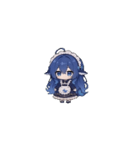

<p align="center"><a href="README.md">中文（默认）</a> · <a href="README.en.md">English</a> · <a href="README.ja.md">日本語</a> · <a href="README.ko.md"><strong>한국어</strong></a></p>

<p align="center"></p>
<h1 align="center">desktop pet</h1>
<p align="center"><strong>함께 만드는 데스크톱 친구: 사용자 지정 동작, 캐릭터 성격, 선택형 플러그인, 여러 AI 도구의 작업 연동.</strong></p>
<p align="center"><a href="https://github.com/xunguangzlj-cloud/desktop-pet-community/releases/latest">앱 다운로드</a> · <a href="https://desktoppet-e9e.pages.dev">공동 창작 플랫폼</a> · <a href="https://github.com/xunguangzlj-cloud/desktop-pet-community/issues">문제 신고</a></p>
<p align="center">
  
  
  
  
  
</p>

## 1. 주요 기능

- **데스크톱 친구**: 드래그로 이동하고 크기를 바꾸거나 숨길 수 있습니다. 조용한 모드에서는 기본적으로 대기하며 클릭할 때 임의의 동작으로 반응합니다. 조용한 모드를 끄면 동작을 임의로 재생하며, 연결한 AI의 실제 작업 상태를 우선합니다.
- **사용자 지정 동작**: 스프라이트 시트, 애니메이션 WebP, 동영상을 사용합니다. 동작의 이름과 종류, 무작위 재생 후보, AI 상태·클릭·드래그 등의 연결을 수정할 수 있습니다.
- **펫과 대화**: 펫의 두뇌에 자신의 클라우드 또는 로컬 AI를 연결합니다. 여러 공급자와 호환 엔드포인트를 지원하며, 입력 및 답변 말풍선과 글꼴을 바꾸고 제어 센터에서 시간 표시가 있는 대화 기록을 확인할 수 있습니다.
- **캐릭터 성격**: 전역 Markdown을 작성하거나 정리된 캐릭터 Skill 및 Tavern V1/V2/V3 JSON·PNG 캐릭터 카드를 가져오고, 설정한 AI로 참고 자료에서 성격을 추출할 수 있습니다. 활성화한 Skill은 일반 대화에 자동 적용됩니다. Skill에 포함된 임의의 스크립트나 도구를 자동 실행하지는 않습니다.
- **여러 AI의 작업 상태**: 연결한 세션들의 상태, 사용 중인 도구, 성공적으로 편집한 파일 수를 한 펫으로 표시합니다. Codex와 ZCode는 Hook을 사용하며 다른 도구는 해당 연결 환경이 필요합니다. 작업 모니터링과 대화용 AI는 별도로 설정합니다.
- **지원되는 사용량 정보**: Codex의 공식 읽기 전용 구독 한도, DeepSeek 대화 공급자의 공식 잔액, OpenRouter 공식 API 키 한도 어댑터를 지원합니다. 연결되지 않았거나 확인할 수 없는 값은 알 수 없음으로 표시합니다. 대화 토큰 사용량을 다른 AI 도구의 잔여 한도로 계산하지 않습니다.
- **선택형 플러그인**: 물 마시기, 자리에서 일어나기, 눈 휴식, 포모도로, 파일 도우미, 컴퓨터 관리 등을 필요에 따라 설치합니다. 알림은 같은 펫 대화 기록에 표시됩니다. 파일 정리는 계획을 먼저 검토하며 컴퓨터 관리 기능은 모니터링과 제안을 제공합니다.
- **공동 창작 플랫폼**: 펫 362개와 플러그인 24개를 제공합니다. Codex Pet의 316개 작품과 원래 작성자·이용 조건을 모두 보존합니다. 좋아요와 다운로드가 많은 작품을 우선 표시합니다. 오른쪽 위에서 중국어·영어·일본어·한국어를 선택하며 선택을 저장합니다. 처음에는 중국어로 표시합니다. 직접 제작과 가져오기는 별도의 경로이며 동영상 동작과 플러그인 표지를 지원합니다.
- **폭넓은 가져오기**: 호환되는 작품은 본 시스템에서 설치·실행합니다. 비호환 프로젝트도 원본 파일을 보존하고 지원하지 않는 조작은 비활성화합니다. 원래 프로그램과 실행 환경을 식별할 수 있는 경우 사용자가 독립 실행을 선택할 수 있습니다.

외부 AI에는 사용자의 계정과 환경 설정이 필요합니다. 연결 항목이나 테스트 통과가 모든 플랫폼의 실제 연결 또는 임의 프로젝트의 완전한 실행을 뜻하지 않습니다. [제공 및 검증 범위](outputs/desktop-pet/docs/release-status.md)를 확인하세요.

### 커뮤니티 펫 예시

| <a href="https://desktoppet-e9e.pages.dev/#pets/firefly--lingxiaotian"></a> | <a href="https://desktoppet-e9e.pages.dev/#pets/lulu--yogazz"></a> | <a href="https://desktoppet-e9e.pages.dev/#pets/pc2005-dsh-pet"></a> |
|:---:|:---:|:---:|
| **Firefly** | **Lulu** | **[dsh-pet](https://desktoppet-e9e.pages.dev/#pets/pc2005-dsh-pet)** |
| <a href="https://desktoppet-e9e.pages.dev/#pets/bongocat-vladelaina"></a> | <a href="https://desktoppet-e9e.pages.dev/#pets/cloud-lykinzlj1"></a> | <a href="https://desktoppet-e9e.pages.dev/#pets/danya-pet-windows"></a> |
| **BongoCat** | **진주** | **다니야** |

## 2. 설치 방법

### Windows 포터블 버전

1. [Windows 바로 다운로드](https://github.com/xunguangzlj-cloud/desktop-pet-community/releases/download/v4.0.4/desktop-pet-4.0.4-windows-x64-portable.zip)에서 ZIP을 받고, 같은 [v4.0.4 릴리스](https://github.com/xunguangzlj-cloud/desktop-pet-community/releases/tag/v4.0.4)의 `SHA256SUMS.txt`도 확인하세요. 자동 생성되는 `Source code` ZIP은 소스 코드입니다.
2. 쓰기 가능한 폴더(예: `D:\Apps\desktop-pet`)에 **ZIP 전체를 압축 해제**하세요. `resources`와 런타임 파일을 함께 두고 EXE만 이동하거나 압축 파일 안에서 실행하지 마세요.
3. `desktop-pet.exe`를 실행하세요. 런타임을 포함하므로 Node.js와 Python을 별도 설치할 필요가 없습니다. 최초 실행 시 로컬 프로필을 만들며 제작자의 AI 계정이나 개인 설정은 포함하지 않습니다.
4. 평소에는 같은 EXE나 바탕 화면 바로 가기를 실행합니다. 기본 펫은 AI 연결 없이도 사용할 수 있습니다. 플러그인은 플랫폼에서 개별 설치하세요.

Windows x64와 macOS arm64를 제공합니다. Windows는 코드 서명이 없으며 Linux 및 Windows ARM의 검증된 패키지는 아직 없습니다. 제어 센터의 설정에서 GitHub 업데이트를 확인할 수 있고 기존 성격·플러그인·대화·AI 설정은 보존합니다.

```powershell
Get-FileHash -Algorithm SHA256 .\desktop-pet-4.0.4-windows-x64-portable.zip
```

같은 릴리스의 `SHA256SUMS.txt`와 비교하세요. 일치하는 해시는 파일 일관성을 확인하며 전체 보안 감사를 대신하지 않습니다.

### macOS (Apple Silicon / arm64)

[Mac 바로 다운로드](https://github.com/xunguangzlj-cloud/desktop-pet-community/releases/download/v4.0.4/desktop-pet-4.0.4-mac-arm64.zip)를 전체 압축 해제하고 `desktop-pet.app`을 응용 프로그램 폴더로 옮겨 실행하세요.

macOS arm64 빌드와 PR #2의 패키징 수정을 반영했습니다. Apple Developer ID 서명과 공증은 아직 없습니다. Gatekeeper가 확인을 요청하면 신뢰할 수 있는 파일인지 확인한 뒤 시스템 설정의 개인정보 보호 및 보안에서 허용하세요. 실제 arm64 패키지의 네이티브 Sharp, 제어 센터, 펫, 중국어 대화, ZIP 알림 플러그인 및 정상 종료를 CI로 검증했습니다. 모든 Mac 모델이나 외부 AI 계정에 대한 검증은 아닙니다. [macOS 빌드](https://github.com/xunguangzlj-cloud/desktop-pet-community/actions/workflows/macos.yml)를 참조하세요.

소스에서 Mac 패키지를 만들려면 Node.js 24, pnpm 11.0.8, Xcode Command Line Tools가 필요합니다.

```bash
git clone https://github.com/xunguangzlj-cloud/desktop-pet-community.git
cd desktop-pet-community/outputs/desktop-pet
pnpm install --frozen-lockfile
pnpm build
pnpm --filter @open-pets/desktop exec electron-builder --mac --arm64 --publish never
node apps/desktop/dist/check-packaging-contract.js --output --platform darwin --arch arm64
```

결과는 `apps/desktop/dist-electron/`에 있습니다. Windows 전용 기능과 원 Windows EXE, 외부 호스트는 각각의 환경이 필요합니다.

### 소스 개발 및 웹사이트 빌드

```powershell
git clone https://github.com/xunguangzlj-cloud/desktop-pet-community.git
cd desktop-pet-community\outputs\desktop-pet
pnpm install
pnpm build
pnpm --filter @open-pets/desktop dev
```

Node.js 24와 pnpm 11.0.8을 권장합니다. 디렉터리 패키지는 `pnpm --filter @open-pets/desktop package:dir`로 만듭니다. 일부 내부 패키지 이름과 프로토콜 필드는 호환성을 위해 원래 값을 유지합니다. 릴리스 설치에는 위 명령이 필요하지 않습니다.

저장소 루트에서 자신의 웹사이트를 빌드하려면:

```powershell
npm ci --prefix outputs/community-site
node outputs/community-host/scripts/build.mjs
node outputs/community-cloudflare/scripts/build.mjs
```

[Cloudflare 설정 예제](outputs/community-cloudflare/wrangler.toml.example)를 자신의 `wrangler.toml`로 복사해 계정과 D1 식별자를 채우고, `deployment-migrations`의 `0000`, `0001`, `0011`을 순서대로 적용하세요. `HASH_SALT`는 플랫폼 비밀 값으로 설정합니다. 제작자의 배포 자격 증명은 저장소에 없습니다.

## 3. 사용 방법

| 조작 | 용도 |
| --- | --- |
| 펫 드래그 | 위치 이동 |
| 펫 클릭 | 조용한 모드에서 임의 동작 재생 |
| 오른쪽 클릭 → 제어 센터 | 펫, AI, 성격, 스타일, 플러그인 관리 |
| 오른쪽 클릭 → 동작 | 동작 선택, 조용한 모드, 사용자 지정 |
| 오른쪽 클릭 → 숨기기 | 펫 숨기기; 시스템 트레이에서 다시 표시 |
| 오른쪽 클릭 → 대화 / 연속 두 번 오른쪽 클릭 | 펫 옆의 같은 입력창 열기 |
| 오른쪽 클릭 → 크기 | 표시 크기 변경 |
| 대화창 오른쪽 위 × | 대화 기록을 보존하며 입력창 닫기 |

### 대화와 성격 및 작업 모니터링

1. 제어 센터의 AI 연결(接入 AI)에서 공급자, 모델, 엔드포인트를 저장하고 연결을 시험한 뒤 펫의 두뇌를 선택합니다. API 키는 로컬 설정에 입력하고 저장소에 제출하지 마세요.
2. 성격(人设个性)에서 전역 Markdown을 작성하거나 정리된 Skill 가져오기(导入已蒸馏 Skill)를 선택합니다. `SKILL.md`, `manifest.json`, `references/` 전체를 보존하고 활성화 상태를 확인하세요.
3. 외부 AI 도구 연결(连接外部 AI 工具)에서 설치된 Codex, ZCode 등을 설정합니다. 각 도구의 Hook 신뢰를 확인하고 새 세션이 설정을 읽도록 하세요. 대화 공급자 설정은 작업 모니터링 설정과 다릅니다.
4. 사용량 페이지는 지원되는 공식 데이터와 시각을 표시합니다. 인터페이스가 없거나 로그인되지 않았거나 데이터가 오래된 경우 알 수 없음 / 확인 대기(未知／待确认) 상태를 따릅니다.

[펫 두뇌](outputs/desktop-pet/docs/companion-ai.md), [캐릭터 성격](outputs/desktop-pet/docs/companion-persona.md), [외부 AI 연결](outputs/desktop-pet/docs/agent-integrations.md)에 상세 설명이 있습니다.

### 펫과 플러그인 및 작품 제출

[플랫폼](https://desktoppet-e9e.pages.dev)에서 ZIP을 다운로드하고 제어 센터의 내 펫(我的桌宠) 또는 플러그인 관리(插件管理)에서 ZIP이나 폴더를 가져오세요. 호환성과 권한을 검토한 뒤 활성화합니다. 새 프로필에는 모든 플러그인이 미리 설치되어 있지 않습니다.

웹사이트와 로컬 펫 전체 패키지는 **1 GiB**, 단일 파일 **512 MiB**, **10,000개 항목**까지 허용하며 Codex 시트는 **100 MiB**입니다. 로컬 네이티브 SDK 플러그인은 전체 **32 MiB**, 단일 파일 **5 MiB**, 진입 코드 **1 MiB**입니다. 압축 해제된 크기도 확인합니다. 큰 작품은 독립 캐릭터별로 나누거나 완전한 패키지 링크를 제출하세요. 분할 압축은 지원하지 않습니다.

웹사이트에서 작품을 패키징하고 정보를 입력한 뒤 이 저장소의 GitHub 제출 양식을 엽니다. 자신의 GitHub 계정으로 파일을 첨부하고 제출하면 관리자가 검토합니다. 패키징 성공만으로 공개되지는 않습니다. 원 프로젝트 보존과 독립 실행 범위는 [펫 및 가져오기](outputs/desktop-pet/docs/pets.md)를 확인하세요.

## 4. 기여자

<!-- CONTRIBUTORS_START -->
<p>
  <a href="https://github.com/xunguangzlj-cloud"></a>
  <a href="https://github.com/wuxuancheng66"></a>
  <a href="https://github.com/huty828"></a>
  <a href="https://github.com/jibo1601-lang"></a>
</p>
<!-- CONTRIBUTORS_END -->

펫, 코드, 문서, 검토 및 아이디어를 제공한 모든 분께 감사합니다. 원래 작품 작성자의 이름은 플랫폼과 다운로드 패키지에 유지합니다.

[펫 제출](https://github.com/xunguangzlj-cloud/desktop-pet-community/issues/new?template=pet-submission.yml) 또는 [플러그인 제출](https://github.com/xunguangzlj-cloud/desktop-pet-community/issues/new?template=plugin-submission.yml)에 전체 파일, 실행 환경, 실제 작성자와 이용 조건을 포함하세요. 코드와 테스트는 Pull Request로 제출합니다. 키·개인 프로필·대화 기록을 포함하지 마세요. 관리자는 검토, 시험, 카탈로그 반영, 배포 후 공개합니다. [기여 안내](CONTRIBUTING.md)와 [제출 유지 관리 절차](docs/submission-maintenance.md)를 참조하세요.

## 5. 감사의 말

- [OpenPetsHQ/openpets](https://github.com/OpenPetsHQ/openpets): 데스크톱 기반, 플러그인 SDK, 도구 연결 구현. 원 MIT 본문과 저작권 표시를 보존합니다.
- [legeling/awesome-codex-pet](https://github.com/legeling/awesome-codex-pet) 및 [Codex Pet](https://codexpet.top/): 커뮤니티·광장·공동 창작 참고와 316개 원 작품 자료. 개별 이용 조건과 작성자를 유지합니다.
- Electron, React, Vite, TypeScript, Sharp, Cloudflare와 유지 관리자.
- 모든 펫·플러그인·글꼴·소재 제작자, 피드백과 테스트를 제공한 분들.

코드·글꼴·플러그인·캐릭터 소재는 각각의 조건을 따릅니다. [제3자 고지](THIRD-PARTY-NOTICES.md)를 참조하세요.

## 6. 라이선스 및 저작권

| 내용 | 적용 범위 |
| --- | --- |
| 본 프로젝트 자체 코드·문서·템플릿 | [MIT License](LICENSE), Lykinzlj 저작권 표시 |
| 가져온 데스크톱 코드 | [원 OpenPets MIT 및 저작권](outputs/desktop-pet/LICENSE) 유지 |
| 플러그인·글꼴·펫 소재 | 각 디렉터리와 ZIP의 원 `LICENSE`, 작성자, 소재 조건. [THIRD-PARTY-NOTICES.md](THIRD-PARTY-NOTICES.md) 참조 |
| 캐릭터·지식재산·상표·참고 자료 | 해당 권리자의 권리이며 코드 MIT가 추가 권리를 부여하지 않음 |

CC BY, CC BY-NC, 개인 이용, 원 저장소 한정, 별도 허가 등 원 조건을 그대로 보존합니다. 모든 작품을 수록하더라도 이용·수정·재배포·상업적 이용에 대한 새로운 허가를 부여하지 않습니다. 모든 캐릭터와 참고 자료에 독립적인 공식 승인을 받았다고 주장하지 않습니다. 제출자는 허가할 수 있는 내용과 조건을 명시해야 합니다.

개인 프로필·자격 증명·대화·로그·브라우저 상태·과거 제작 기록은 소스 또는 휴대용 릴리스에 포함하지 않습니다. 사용자가 AI를 활성화하면 해당 공급자의 조건에 따라 요청합니다. 전송 내용과 플러그인 권한을 확인하세요. [현재 검증 범위](outputs/desktop-pet/docs/release-status.md)를 참조하세요.

## 7. Star와 제작자 지원

도움이 되었다면 Star를 눌러 주세요! 제작자에게 밀크티 한 잔을 선물하셔도 좋습니다. ♥ 피드백, 작품 공유, 기여도 환영합니다.

<p align="center">
  <a href="assets/donate/alipay.jpg"></a>
  &nbsp;&nbsp;
  <a href="assets/donate/wechat.jpg"></a>
</p>
